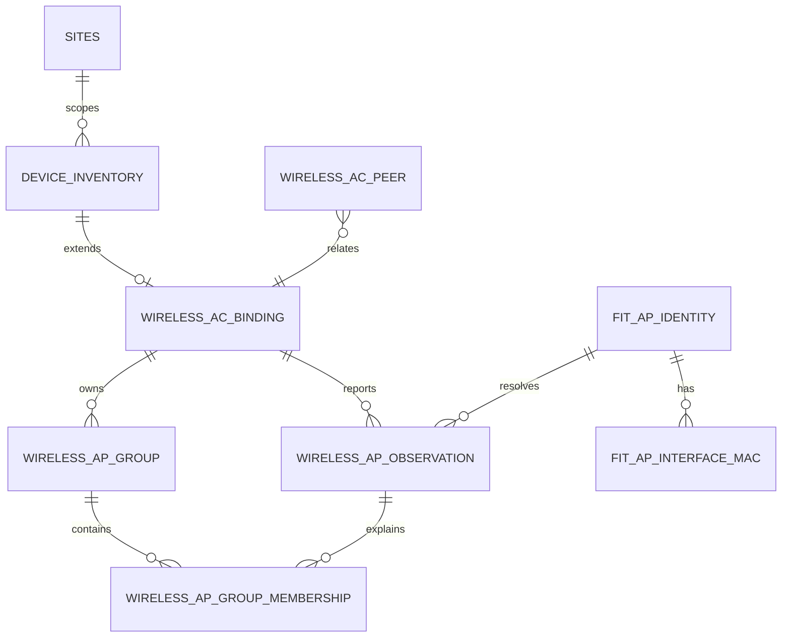

# AC/AP 关系与接口 Schema

本文件是实现前的关系契约。它描述候选表、外键和服务端边界，不执行数据库迁移。

## 1. 关系图



## 2. SQL-like 草案

```sql
CREATE TABLE wireless_ac_binding (
    ac_device_id TEXT PRIMARY KEY REFERENCES device_inventory(id),
    site_id TEXT NOT NULL REFERENCES sites(id),
    mode TEXT NOT NULL CHECK (mode IN ('INDEPENDENT','STACK_MEMBER','CLUSTER','VIRTUAL_PRIMARY_STANDBY')),
    cluster_id TEXT NULL,
    status TEXT NOT NULL CHECK (status IN ('ACTIVE','DISABLED','UNRESOLVED')),
    source TEXT NOT NULL,
    source_revision TEXT NOT NULL,
    created_at INTEGER NOT NULL,
    updated_at INTEGER NOT NULL
);

CREATE TABLE fit_ap_identity (
    id TEXT PRIMARY KEY,
    site_id TEXT NOT NULL REFERENCES sites(id),
    serial_number TEXT NULL,
    primary_mac TEXT NULL,
    identity_status TEXT NOT NULL CHECK (identity_status IN ('ACTIVE','REPLACED','CONFLICT','UNRESOLVED')),
    replacement_of TEXT NULL REFERENCES fit_ap_identity(id),
    confirmed_by TEXT NULL,
    created_at INTEGER NOT NULL,
    updated_at INTEGER NOT NULL
);

CREATE TABLE fit_ap_interface_mac (
    fit_ap_id TEXT NOT NULL REFERENCES fit_ap_identity(id),
    mac TEXT NOT NULL,
    role TEXT NOT NULL CHECK (role IN ('PRIMARY','RADIO','UPLINK','MANAGEMENT','UNKNOWN')),
    source TEXT NOT NULL,
    observed_at INTEGER NOT NULL,
    PRIMARY KEY (fit_ap_id, mac, role, source)
);

CREATE TABLE wireless_ap_group (
    id TEXT PRIMARY KEY,
    ac_device_id TEXT NOT NULL REFERENCES wireless_ac_binding(ac_device_id),
    site_id TEXT NOT NULL REFERENCES sites(id),
    name TEXT NOT NULL,
    normalized_name TEXT NOT NULL,
    source_revision TEXT NOT NULL,
    created_at INTEGER NOT NULL,
    updated_at INTEGER NOT NULL,
    UNIQUE (ac_device_id, normalized_name)
);

CREATE TABLE wireless_ap_observation (
    id TEXT PRIMARY KEY,
    fit_ap_id TEXT NULL REFERENCES fit_ap_identity(id),
    ac_device_id TEXT NOT NULL REFERENCES wireless_ac_binding(ac_device_id),
    site_id TEXT NOT NULL REFERENCES sites(id),
    ap_group_id TEXT NULL REFERENCES wireless_ap_group(id),
    reported_serial TEXT NULL,
    reported_primary_mac TEXT NULL,
    state_raw TEXT NOT NULL,
    state_semantics_version TEXT NOT NULL,
    observed_at INTEGER NOT NULL,
    expires_at INTEGER NULL,
    source_revision TEXT NOT NULL,
    identity_match_kind TEXT NOT NULL CHECK (identity_match_kind IN ('SERIAL','PRIMARY_MAC','MANUAL','UNRESOLVED')),
    conflict_state TEXT NOT NULL CHECK (conflict_state IN ('NONE','IDENTITY_CONFLICT','SITE_CONFLICT','QUARANTINED')),
    payload_ref TEXT NULL
);

CREATE TABLE wireless_ap_group_membership (
    observation_id TEXT NOT NULL REFERENCES wireless_ap_observation(id),
    fit_ap_id TEXT NULL REFERENCES fit_ap_identity(id),
    group_id TEXT NOT NULL REFERENCES wireless_ap_group(id),
    valid_from INTEGER NOT NULL,
    valid_to INTEGER NULL,
    source_revision TEXT NOT NULL,
    conflict_state TEXT NOT NULL,
    PRIMARY KEY (observation_id, group_id)
);

CREATE TABLE wireless_ac_peer (
    cluster_id TEXT NOT NULL,
    left_ac_device_id TEXT NOT NULL REFERENCES wireless_ac_binding(ac_device_id),
    right_ac_device_id TEXT NOT NULL REFERENCES wireless_ac_binding(ac_device_id),
    relation_role TEXT NOT NULL,
    source_revision TEXT NOT NULL,
    observed_at INTEGER NOT NULL,
    confidence TEXT NOT NULL,
    PRIMARY KEY (cluster_id, left_ac_device_id, right_ac_device_id, source_revision)
);
```

数据库具体类型、迁移工具和现有 SQLite 命名风格在 P1 实施前再对齐；不得直接把上述草案当成可执行迁移。

## 3. 约束补充

### 3.1 身份唯一性

有效且非空的 `serial_number` 与 `primary_mac` 应分别唯一；`CONFLICT` 候选可重复但必须隔离，不能被普通列表当成有效身份。MAC 写入前必须规范化。若 SQLite 版本不支持部分唯一索引，使用触发器或事务内检查实现相同约束。

### 3.2 Site 一致性

`wireless_ac_binding.site_id` 必须等于引用设备库存的 Site。`wireless_ap_group.site_id` 必须等于所属 AC Binding 的 Site。观测、AP 身份和组关系的 Site 不一致时整条写入拒绝；不要依赖应用层先查后写的非原子校验。

### 3.3 观测幂等

采集器重试使用同一个 `source_revision` 和稳定观测键，不产生第二条逻辑观测。推荐在应用层构造规范化幂等键，并在事务中唯一检查；原始负载引用不存密码、Credential Reference 或终端会话秘密。

### 3.4 时间与保留

`observed_at` 是来源事实时间，`created_at/updated_at` 是本地持久化时间。过期观测保留用于审计，但不参与当前状态投影。历史观测不做覆盖更新，仅允许追加冲突修正事件。

## 4. API 资源形状

无线列表建议返回以下稳定字段：

```json
{
  "fitApId": "ap-...",
  "siteId": "site-a",
  "serialNumber": "...",
  "primaryMac": "aabbccddeeff",
  "state": "PRIMARY",
  "stateRaw": "R/M",
  "stateSemanticsVersion": "ASSUMPTION_PENDING_H3C_EVIDENCE",
  "sourceAcs": [{"deviceId": "ac-1", "observedAt": 0, "sourceRevision": "..."}],
  "group": {"id": "group-1", "name": "办公区"},
  "conflictState": "NONE",
  "freshness": "FRESH"
}
```

响应不能返回密码、私钥、DPAPI 内容或内部 Credential Reference。涉及修改的 API 必须复用现有认证、Site Scope、CSRF、幂等和审计中间件。

## 5. 迁移策略

未来实施只允许增量迁移：先建表和索引，再启用只读投影，完成回放/冲突验证后才打开写入。迁移失败必须由单事务或明确版本门禁保证不会留下半套表结构或半套关系。现有 `device_inventory`、Terminal Profile 和历史终端记录不迁移、不复制、不重命名。
